Forma keeps everything durable in PostgreSQL 18 or newer. The schema is defined only by the [goose](https://github.com/pressly/goose) SQL migrations in [`server/migrations/`](https://github.com/yldm-tech/forma/tree/main/server/migrations); the Go server reads and writes it through [GORM](https://gorm.io/) with the pgx driver and never lets GORM migrate anything. The schema supports multi-tenancy, survey management and response collection while keeping organizations apart.

## Entity Relationship Diagram

The core tables and their relationships:

```mermaid
erDiagram
    organizations ||--o{ workspaces : "has many"
    organizations ||--o{ memberships : "has many"
    organizations ||--o{ teams : "has many"
    organizations ||--o{ invites : "sends"
    organizations ||--o{ api_keys : "owns"
    organizations ||--|| organization_billing : "has"

    workspaces ||--o{ languages : "supports"
    workspaces ||--o{ workspace_teams : "has"
    workspaces ||--o{ surveys : "contains"
    workspaces ||--o{ contacts : "tracks"
    workspaces ||--o{ action_classes : "defines"
    workspaces ||--o{ api_key_workspaces : "grants"
    workspaces ||--o{ integrations : "configures"
    workspaces ||--o{ webhooks : "calls"
    workspaces ||--o{ workflows : "automates"
    workspaces ||--o{ tags : "labels"

    surveys ||--o{ responses : "receives"
    surveys ||--o{ displays : "tracks"
    surveys ||--o{ survey_triggers : "configured by"
    surveys ||--o{ survey_languages : "translated to"
    surveys ||--o{ survey_quotas : "limited by"

    contacts ||--o{ responses : "provides"
    contacts ||--o{ displays : "sees"
    contacts ||--o{ contact_attributes : "has"

    users ||--o{ memberships : "belongs to"
    users ||--o{ user_identities : "signs in with"
    users ||--o{ team_members : "member of"

    teams ||--o{ team_members : "includes"
    teams ||--o{ workspace_teams : "has access to"
    api_keys ||--o{ api_key_workspaces : "scopes"

    responses ||--o{ response_tags : "tagged with"
    tags ||--o{ response_tags : "applied to"
    action_classes ||--o{ survey_triggers : "triggers"
    contact_attribute_keys ||--o{ contact_attributes : "defines"

    workflows ||--o{ workflow_versions : "published as"
    workflows ||--o{ workflow_runs : "runs"
    workflow_runs ||--o{ workflow_run_logs : "traces"
```

## Conventions

The header of `00001_baseline.sql` states them; in short:

- **Names**: snake_case plural tables, `timestamptz` everywhere.
- **Primary keys**: `uuid` defaulting to `uuidv7()`, which is why PostgreSQL 18 is the minimum. Rows migrated from forma2 get `uuidv5(<forma legacy namespace>, <old id>)` instead, so an old id that arrives from outside (a survey link, an SDK snippet) resolves by computing the same function. `server/internal/platform/legacyid` holds the namespace and the resolver; use it rather than a copy.
- **Closed value sets** are `text` with a `CHECK`, never PostgreSQL enums, so adding a value is a one-line migration and removing one is possible at all.
- **Documents** (survey blocks, endings, styling, workflow definitions, response data) are `jsonb`. They are validated in Go, in the service that owns them, against JSON Schemas exported from the zod definitions in `packages/types` (`server/internal/jsonschema/schemas/`), plus the refinements a JSON Schema cannot express.

## Core Tables

### Tenancy and identity

- **organizations** are the top-level tenant. **organization_billing** holds the plan, limits and Stripe state of one.
- **workspaces** group surveys, contacts, actions, integrations and their settings, inside one organization. A workspace migrated from forma2 keeps the environment id old SDK snippets still send in `legacy_environment_id`.
- **users** are the people who sign in. **user_identities** holds one row per way to sign in: a password (`credential`, with its bcrypt hash) or an external identity (Google, GitHub, Azure AD, OpenID, SAML). **sessions** and **verifications** hold session tokens and single-use tokens by hash only.
- **memberships** give a user a role in an organization (owner, manager, member, billing); **teams**, **team_members** and **workspace_teams** give teams read, read-write or manage access to workspaces.
- **api_keys** belong to an organization and reach workspaces through **api_key_workspaces** (read, write or manage). A key is stored as a SHA-256 lookup hash and a bcrypt verification hash.

### Surveys and responses

- **surveys** hold the survey document (`welcome_card`, `blocks`, `endings`, `hidden_fields`, `variables`) and its settings. **survey_triggers**, **survey_attribute_filters**, **survey_languages**, **survey_quotas**, **survey_follow_ups** and **segments** configure who sees it, in which languages and what happens after.
- **displays** record a survey shown; **responses** record the answers (`data`), with the respondent's contact and metadata when known. **tags** and **response_tags** label responses.
- **contacts**, **contact_attribute_keys** and **contact_attributes** are the people surveys are shown to and the typed attributes targeting reads.
- **action_classes** are the code and no-code actions that trigger app surveys.

### After a response

- **webhooks**, **integrations** and **integration_credentials** (encrypted) send responses elsewhere.
- **workflows**, **workflow_versions**, **workflow_runs** and **workflow_run_logs** are the workflow builder's definitions, their published versions and the runs they produced.

### Authorization projection

- Triggers on every table that carries authorization data (organizations, memberships, users, teams, team members, workspaces, workspace teams, API keys and their workspace grants) enqueue a row in **authz_projection_outbox** in the same transaction as the change. The worker delivers those rows to SpiceDB, retrying with backoff. A table of that kind added later needs a trigger too, plus its projector and reconciliation in `server/internal/authz`.

### Job queue

River's tables (`river_job`, `river_queue`, ...) are versioned by River itself. `forma migrate` applies them after the goose migrations, and they never appear in `server/migrations/`.

## Schema Management

- A schema change is a new numbered goose file in `server/migrations/` with both an `-- +goose Up` and a `-- +goose Down` section. A migration that has shipped is never edited.
- `make migrate` (or `forma migrate`, which needs `DATABASE_URL` alone, or `MIGRATE_DATABASE_URL` when the schema owner is a different role) applies pending migrations under a lock, so concurrent migrators take turns. `forma start` runs it before serving unless `SKIP_STARTUP_MIGRATION` is set.
- New and changed migrations are linted with [Squawk](https://squawkhq.com/) on every pull request (`scripts/lint-migrations.sh`, `server/.squawk.toml`): the Up section only, in a transaction unless the file says `-- +goose NO TRANSACTION`. Set a `lock_timeout` before statements that take strong locks on existing tables, and build indexes on existing tables `CONCURRENTLY` in a migration without a transaction.
- `server/internal/platform/database/migrate_test.go` applies every migration to a real PostgreSQL and checks the constraints and triggers; `server/internal/platform/pgtest` gives each Go test a fresh migrated database.

For the exact columns, constraints and indexes, read the migrations: they carry a comment on every choice that is not obvious.
