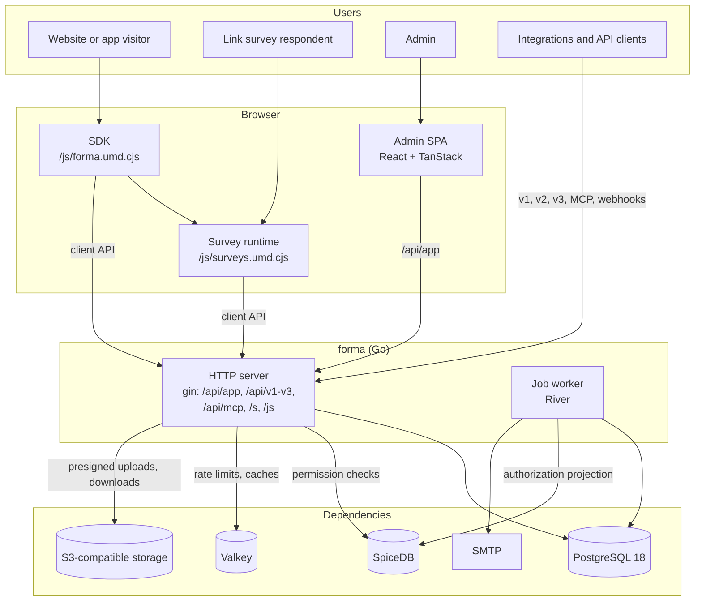

Forma is one Go binary, `forma`, that serves the API, the public survey pages and the admin single-page app, runs the background jobs, and migrates its own database. The browser code is a React SPA built with Vite and embedded into that binary; the survey runtime and the customer-site SDK are the two JavaScript bundles it serves under `/js/*`. This page describes how those parts fit together. [AGENTS.md](https://github.com/yldm-tech/forma/blob/main/AGENTS.md) is the working reference for the conventions behind them.

## System Architecture

### Processes

`forma` is a single binary whose first argument picks the process:

- `forma serve` runs the HTTP server: the admin API under `/api/app`, the public APIs (`/api/v1/client`, `/api/v2/client`, `/api/v1/management`, `/api/v2`, `/api/v3`), the MCP server at `/api/mcp` with its OAuth authorization server, the public survey pages (`/s`, `/c`, `/p`), stored files, the SDK bundles under `/js/*`, and the SPA for every other path.
- `forma worker` runs the background jobs (River on PostgreSQL): pipeline steps after a response, webhooks, integrations, workflows, follow-up emails, scheduled survey status changes, retention, and the delivery of the SpiceDB projection.
- `forma start` is the container's default: it validates the configuration, migrates unless `SKIP_STARTUP_MIGRATION` is set, and serves with the worker in the same process unless `BULLMQ_WORKER_ENABLED=0`.
- `forma migrate` applies the goose schema and then River's tables; `forma authz` operates the SpiceDB schema, backfill and outbox; `forma seed` writes development data.

### Server modules

The server lives in `apps/server/` (Go module `github.com/yldm-tech/forma/apps/server`). Each feature is one package under `apps/server/internal/<feature>/`, layered handler → service → repository, and wired together in `apps/server/internal/app` with [wire](https://github.com/google/wire). Cross-cutting infrastructure (configuration, logging, the database, rate limits, mail, audit events, the job queue) is in `apps/server/internal/platform/`.

Authorization is decided in the service layer: PostgreSQL decides existence and tenancy, then SpiceDB decides the permission. Services never write SpiceDB directly. Every table that carries authorization data has a trigger that enqueues a row in `authz_projection_outbox` in the same transaction, and the worker delivers those rows to SpiceDB. See [Tenant Separation](/development/technical-handbook/tenant-separation).

### Browser code

- **Admin SPA** (`apps/web/`): React 19, TanStack Router (file-based routes in `apps/web/src/routes/`) and TanStack Query, Tailwind CSS 4, i18next. Built by Vite, copied into `apps/server/internal/webui/dist` and embedded with `go:embed`. Its second entry, `survey.html`, is the public survey page the server fills for `/s`, `/c` and `/p`.
- **Survey runtime** (`packages/surveys`): the Preact runtime that renders a survey, on the public survey pages and inside the SDK.
- **SDK** (`packages/js-core`): what a customer embeds on their website or app. It loads the runtime and talks to the client API.

### Data

- **PostgreSQL 18** holds everything durable, including the job queue. The schema is defined only by the goose migrations in `apps/server/migrations/`. See [Database Model](/development/technical-handbook/database-model).
- **SpiceDB** answers permission questions over the relationships projected from PostgreSQL.
- **Valkey** holds rate-limit counters and short-lived caches. When it is unreachable, rate limits let requests through.
- **S3-compatible storage** (RustFS in development) holds uploaded files; browsers upload to it with presigned requests.

## Technology Stack

- **Server**: Go, gin, GORM with pgx, wire, River, goose, the official MCP Go SDK
- **Authorization**: SpiceDB
- **Admin UI**: React, TanStack Router and Query, Tailwind CSS, Radix UI, i18next
- **Survey runtime and SDK**: Preact, TypeScript
- **Toolchain**: Vite+ (`vp`: Vite, Vitest, Oxlint, Oxfmt, tsgolint), pnpm workspaces, golangci-lint
- **API**: REST, with the v3 API specified first in OpenAPI (`apps/docs/api-v3-reference`)
- **Testing**: Go tests with testcontainers, Vitest, Playwright for the browser suite, Schemathesis for the v3 contract
